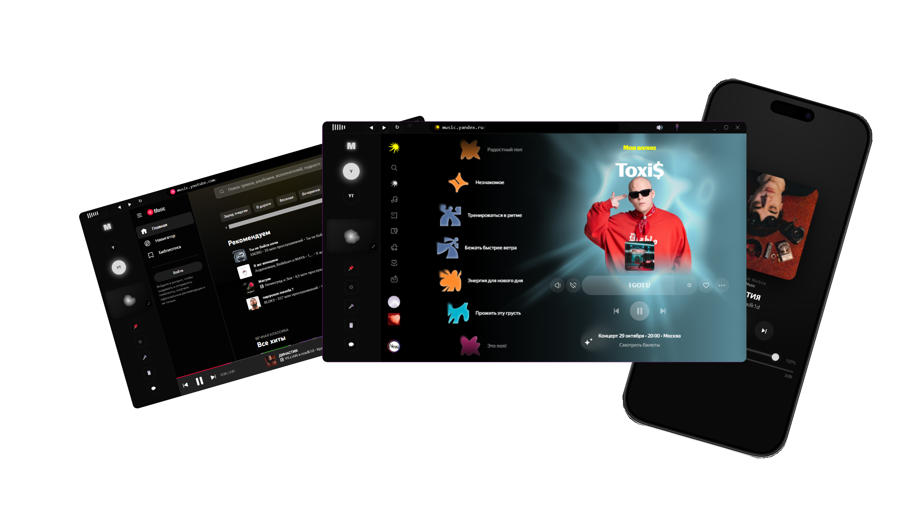

# 🎵 MusicHub

**MusicHub** — это мощный десктопный музыкальный плеер-агрегатор, который объединяет несколько стриминговых сервисов в одном окне, дополненный умными визуализациями, AI-ассистентом и полной кастомизацией интерфейса. Это мой инженерный проект, созданный для изучения и применения современных технологий.

[](https://www.electronjs.org/)
[](LICENSE)
[](http://makeapullrequest.com)



<div align="center">
  <br/>
  <a href="https://download.mawba-1230.workers.dev/">
    
  </a>
  &nbsp;&nbsp;
  <a href="https://mamba1230.github.io/">
    
  </a>
  <br/>
  <br/>
</div>

---

## 🚀 Ключевые возможности

*   **Мультисервисность:** Поддерживает Яндекс Музыку, YouTube Music, SoundCloud, Apple Music, VK Music и любые кастомные URL.
*   **Умные визуализации:** Более 10 режимов (полосы, волна, круг, частицы, GIF, 3D-режимы), реагирующих на звук в реальном времени.
*   **Гибкое управление:**
    *   Горячие клавиши с полной перенастройкой.
    *   **Мобильный пульт** (интерфейс по QR-коду) с синхронизацией статуса через WebSocket.
    *   Управление плеером через AI-ассистента.
*   **AI-ассистент нового поколения:**
    *   Интеграция с GigaChat.
    *   Управление плеером через текстовые команды (`найди песню`, `включи/выключи`, `следующий трек`).
    *   Контекстный диалог и работа с базой знаний.
*   **Кастомизация:** Тёмная/светлая темы, выбор акцентного цвета, настройка поведения окна (стиль кнопок macOS/Windows, масштаб 80-120%), система плагинов.
*   **Продвинутый звук (C# модуль):**
    *   Захват аудиосистемы напрямую через WASAPI (без Virtual Audio Cable).
    *   Передача аудиопотока через WebSocket.
    *   Умное управление громкостью и определение Play/Pause.

---

## 🛠️ Технологический стек

| Технология | Применение |
| :--- | :--- |
| **Electron** | Десктопный фреймворк |
| **HTML / CSS / JS** | Интерфейс и логика |
| **Web Audio API** | Анализ звука, визуализации |
| **WebSocket** | Чат, мобильное управление, аудиопоток |
| **C# / NAudio / WASAPI** | Захват звука, системное управление громкостью |
| **Cloudflare Workers** | Бэкенд, WebSocket-сервер |

---

## 🖥️ Установка и запуск

Проект легко развернуть на любой Windows-машине.

```bash
# Клонируем репозиторий
git clone https://github.com/Mamba1230/musichub.git
cd musichub

# Устанавливаем зависимости
npm install

# Запускаем
npm start
